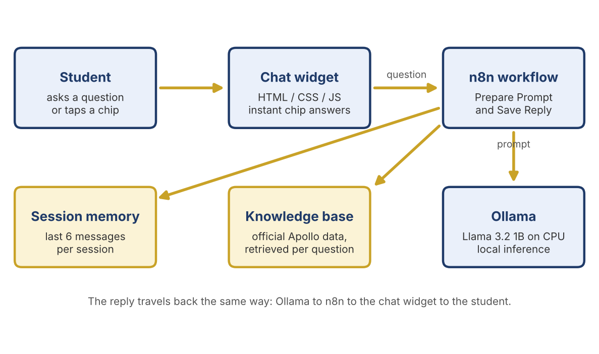

# College Admission AI Chatbot

A locally hosted admission-enquiry chatbot for The Apollo University, Chittoor. A web chat widget sends questions to an **n8n** workflow, which retrieves only the relevant official facts and passes them to **Llama 3.2 1B** running on **Ollama**. No cloud service or paid API is used.

## Files
| Path | What it is |
|---|---|
| `widget/index.html` | Chat widget (HTML/CSS/JS) with suggested-prompt chips, follow-up chips and instant local answers |
| `n8n/1-prepare-prompt.js` | n8n Code node **Prepare Prompt**: topic detection, programme matching, prompt building |
| `n8n/2-save-reply.js` | n8n Code node **Save Reply**: session memory and `{output}` for the widget |
| `data/` | Plain-text knowledge base and syllabus used as facts |
| `docs/` | Mini project report |

## Run it
1. Install Docker Desktop (WSL2) and Ollama, then `ollama pull llama3.2:1b`.
2. Start n8n in Docker and build the workflow: Chat Trigger → Code (`1-prepare-prompt.js`, name it exactly `Prepare Prompt`) → HTTP Request to `http://host.docker.internal:11434/api/chat` (body `{{ JSON.stringify($json.ollamaBody) }}`) → Code to read the reply → Code (`2-save-reply.js`).
3. Put your n8n chat webhook URL in `widget/index.html` and open the file in a browser.

## Notes
- The knowledge base is a snapshot of October 2026 and must be updated by hand.
- Model settings: `num_ctx` 2048, `num_predict` 200, `temperature` 0.2.
